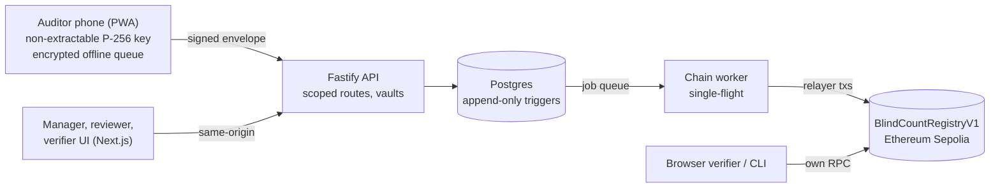

# BlindCount

**Count first. Compare later.** Field inspections that hide the pass threshold from the person counting, seal their first observation onchain, and give buyers a proof packet they can verify themselves.

[](https://github.com/winsznx/blindcount/actions/workflows/ci.yml) [](LICENSE)   

Track: **Sustainable Supply Chains**, IEEE ClimateChain Global Hackathon 2026 · Live app: [blindcount.xyz](https://blindcount.xyz)

## Why it exists

Cocoa sustainability programmes pay for shade trees, and buyers make public claims based on field counts. The people doing those counts usually know the minimum a farm needs to pass. A randomized study of 407 cocoa farms in Côte d'Ivoire found verifiers who could see the threshold amended failing counts far more often: **24.8 points of excess amendments with the threshold shown, 11.2 with it concealed.** We reproduced both figures from the authors' public data ([data/research/reproduce.py](data/research/reproduce.py)).

BlindCount turns that intervention into enforced software:

1. A manager commits a hidden minimum for a cohort of farm visits. It is encrypted under its own key and committed onchain as a salted hash.
2. Auditors count on their phones with no target, no score meter and no hint. The phone signs the observation with a key that never leaves it, and works offline.
3. A salted commitment of each first observation is anchored on Ethereum Sepolia.
4. The criterion unlocks only when every assignment in the cohort is sealed or voided by two people **and the registry contract has closed the cohort**. One finished audit can't leak the target for the rest.
5. Deterministic code evaluates each count. Reviewers approve, dispute, or request a correction. A correction is a new signed version anchored after the original, which never changes.
6. Buyers verify the proof packet in a browser or with an open-source CLI, against their own RPC, without an account. Change one digit and verification names the exact file that no longer matches.

## Live

| | |
|---|---|
| Registry | [`0x4f38eabf65725d38b4c04410c04318869ae3e8e1`](https://sepolia.etherscan.io/address/0x4f38eabf65725d38b4c04410c04318869ae3e8e1) on Ethereum Sepolia, source verified on Sourcify (exact match) |
| Full story on Sepolia | The complete integration suite (publish, sign, anchor, close, disclose, correct, verify) passes against the live contract: `TEST_CHAIN=testnet pnpm --filter @blindcount/api test` |
| Deployment record | [docs/DEPLOYMENTS.md](docs/DEPLOYMENTS.md) |

## What makes it different

- **The reveal unit is the cohort, enforced onchain.** `closeCohort` reverts unless every registered assignment is anchored or voided, and disclosure is only possible after that. The verifier independently checks that a packet's criterion was disclosed after onchain closure.
- **The first count is tamper-evident end to end.** It is signed on the device with a non-extractable P-256 key, stored append-only (database triggers refuse edits), committed onchain with a 32-byte salt bound to chain id and registry, and recomputed by the verifier from the packet.
- **Corrections keep history.** Version 1 is permanent. Corrections are linked, signed, anchored versions, and reports show the original and accepted counts with both outcomes.
- **Verification trusts nothing BlindCount serves.** The same verifier code runs in the browser and the CLI. It pins the issuer's registry and signing key and reads the chain through an RPC the verifier chooses.
- **AI helps reviewers but never decides.** Evidence-quality checks never see the criterion, the count or the outcome, can't set an outcome, and are labelled as suggestions. Duplicate-photo and clock checks run deterministically on every submission.
- **Built for the field.** Mobile-first PWA, encrypted offline drafts, signing before connectivity, and automatic upload on reconnect.

## Architecture



Details: [docs/ARCHITECTURE.md](docs/ARCHITECTURE.md) · Security model and invariant-to-test map: [SECURITY.md](SECURITY.md) · Every public claim with its evidence: [docs/CLAIM_LEDGER.md](docs/CLAIM_LEDGER.md)

## Repository

| Path | What it is |
|---|---|
| `packages/contracts` | `BlindCountRegistryV1` (Solidity 0.8.24, OpenZeppelin 5.1), Foundry tests, deploy script |
| `packages/crypto` | RFC 8785 canonical JSON, SHA-256, salted keccak commitments, P-256 signatures. Same code in Node and browsers |
| `packages/domain` | Schemas, role matrix, state machines, deterministic evaluation, and the packet verifier used by web and CLI |
| `packages/db` | Prisma schema, migrations, integrity triggers |
| `apps/api` | Fastify API and chain worker |
| `apps/web` | Next.js app: public site, field PWA, manager and reviewer workspace, in-browser verifier |
| `apps/verify-cli` | `blindcount-verify`, the reference verifier |
| `e2e` | Playwright: four browser users through the whole story, including offline and corrections |
| `data/research` | Reproduction of the study's headline figures from its public dataset |
| `infra` | Docker Compose, local setup, backup and restore drill |
| `docs` | Architecture, decisions, threat model, runbook, API, deployments, static analysis, claim ledger |

## Run it

Requirements: Node 24, pnpm 12, Docker, Foundry.

```bash
pnpm install
pnpm setup:local      # Postgres, migrations, local chain, registry deploy, .env with fresh secrets
pnpm seed:demo        # optional: labelled demo identities and a simulated programme
pnpm dev              # web http://localhost:3000, API http://localhost:4000
```

Locally, sign-in codes go to `storage/outbox.log`. In production set `EMAIL_PROVIDER=resend` and `RESEND_API_KEY`.

## Test it

```bash
pnpm contracts:test                              # 28 Foundry tests incl. fuzzing and cross-language vectors
pnpm test                                        # crypto, domain, CLI, API integration (live Postgres + chain)
pnpm test:e2e                                    # Playwright, real browser, real chain
TEST_CHAIN=testnet pnpm --filter @blindcount/api test   # the same story against Ethereum Sepolia
pnpm backup:verify                               # dump, restore, compare digests, re-hash evidence
python3 -I data/research/reproduce.py            # recompute the study's figures from the public data
```

## Verify a packet

```bash
pnpm verify:packet -- --packet ./blindcount-proof-<id>.zip \
  --rpc https://ethereum-sepolia-rpc.publicnode.com \
  --registry 0x4f38eabf65725d38b4c04410c04318869ae3e8e1 \
  --trusted-key <fingerprint from /v1/system/chain-config>
# exit 0 verified · 1 invalid · 2 dependency unavailable or issuer not pinned · 3 misuse
```

Or open `/verify`. The packet is parsed in the browser and never uploaded.

## Deploy

- **Web:** Vercel or any Node host. Set `API_INTERNAL_URL` before `next build`, because Next.js resolves rewrites at build time.
- **API, worker, Postgres:** `docker compose -f infra/compose/docker-compose.yml --profile app up -d --build` with a `.env.production` (1 to 2 vCPU, 2 GB RAM, about 10 GB disk).
- **Contract:** already live; see [docs/RUNBOOK.md](docs/RUNBOOK.md) to redeploy.

## Scope of the guarantee

A sealed record proves exactly what was submitted, by which enrolled device, and that it was anchored before the criterion was disclosed. Whether the trees are really there is the reviewer's call, and every report says so. That precision is deliberate: an integrity system that overclaims can't be trusted on anything else.

Research source: Cammelli, Six and Garrett (2026), [doi:10.5061/dryad.v9s4mw77q](https://doi.org/10.5061/dryad.v9s4mw77q), CC0. Farms in the BlindCount demo are simulated and labelled as such.

## License

[MIT](LICENSE)
