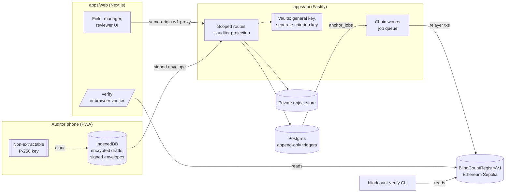
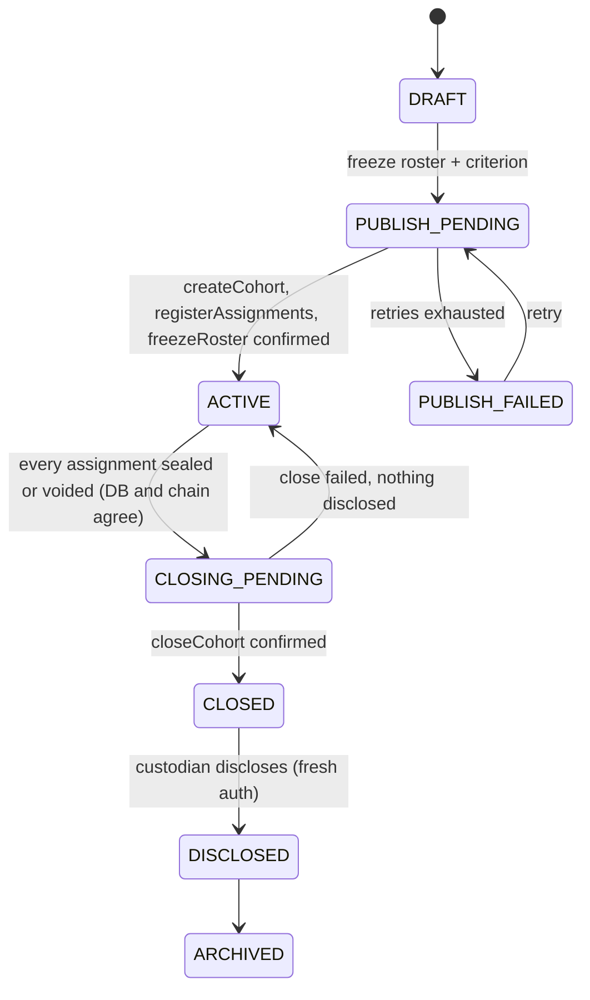
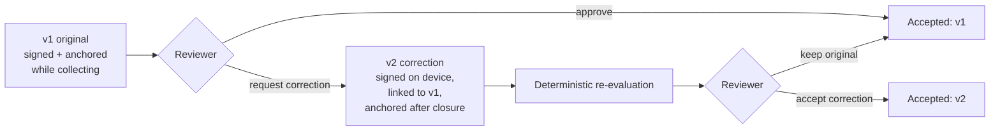
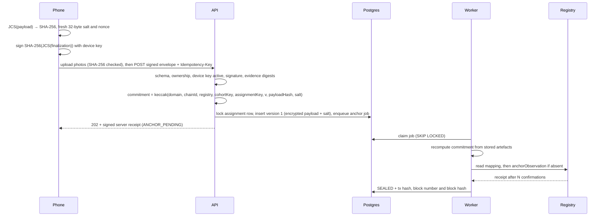

# Architecture

BlindCount has one job: let a programme collect a field count without the collector knowing the pass threshold, and let anyone later prove that the count they are reading is the one first submitted. Everything below serves one of two guarantees:

1. **Concealment.** No auditor-facing surface carries the criterion, its salt or a derived outcome while the cohort is open, and the criterion unlocks only after the registry contract has closed the whole cohort.
2. **Provenance.** The first observation is signed on the device, stored append-only, and committed onchain with a salt, so a verifier can recompute it from a packet without trusting BlindCount's database.

## System view

Field phones never send transactions. The relayer pays gas only after the API has verified the device signature, the payload and the evidence digests.

## Packages

| Package | Responsibility | Depends on |
|---|---|---|
| `packages/crypto` | RFC 8785 canonicalization, SHA-256, salted keccak commitments, P-256 sign/verify. Runs identically in Node 24 and browsers (WebCrypto) | viem |
| `packages/domain` | Zod schemas, role matrix, cohort/assignment state machines, deterministic evaluation, packet format and verifier | crypto, contracts ABI |
| `packages/contracts` | Registry contract, Foundry tests, deploy script, generated `abi.ts` | OpenZeppelin 5.1 |
| `packages/db` | Prisma schema, migrations, integrity triggers | Prisma 6 |
| `apps/api` | HTTP API, worker, report rendering | all packages |
| `apps/web` | UI and in-browser verifier | crypto, domain |
| `apps/verify-cli` | Reference verifier | domain |

The verifier lives in `domain` so the browser and the CLI run the same code. There is exactly one implementation to audit.

## The cohort lifecycle

There is no transition back from `DISCLOSED`, and the criterion row is locked by a database trigger at publish.

## Corrections without rewriting history

The registry accepts version 1 only while a cohort collects, and versions 2+ while it is frozen or closed. A correction never touches the original commitment, the terminal count or a closed cohort's status. Reports print the original and accepted counts with both outcomes, and the verifier requires the packet to carry exactly the versions the registry holds.

## One submission, end to end

## Where each guarantee is enforced

| Guarantee | API | Database | Contract | Client |
|---|---|---|---|---|
| Auditors never get the criterion | `auditorProjection` allowlist; criterion encrypted with its own key; no route compares guesses | ciphertext only; trigger locks the row at publish | only a salted commitment onchain | nothing to leak; UI shows a sealed slot |
| Reveal is per cohort | close requires DB terminal state and onchain `terminal == expected`; disclose requires `CLOSED` | state transitions in row-locked transactions | `closeCohort` requires every assignment terminal; `recordDisclosure` only after close | — |
| First observation is immutable | PATCH always 409; one version 1 per assignment; corrections are new linked versions | append-only trigger; unique `(observation, version)` | version 1 once and only while collecting; versions contiguous | envelope signed before any network call |
| Exactly-once anchoring | idempotency key, nonce uniqueness | unique `event_key` | `NonContiguousVersion` revert | persistent idempotency key per finalization |
| Independent verification | — | — | public commitments | verifier recomputes everything from the packet + RPC |

## Trust boundaries

- **Organization relayer.** It attests device enrollment and pays gas. A verifier relies on the organization's published report-signing key fingerprint and registry address.
- **Criterion custodian.** Knows the target. The guarantee is that auditors cannot get it from the app, not that people cannot tell each other.
- **Platform operator.** Could access the application encryption keys. Customer-managed keys are future work.
- **Device clocks.** Recorded as claims only. Server receipt and block time are the trusted timestamps.

See [THREAT_MODEL.md](THREAT_MODEL.md) for threats and tests, and [DECISIONS.md](DECISIONS.md) for deviations from the PRD stack.
